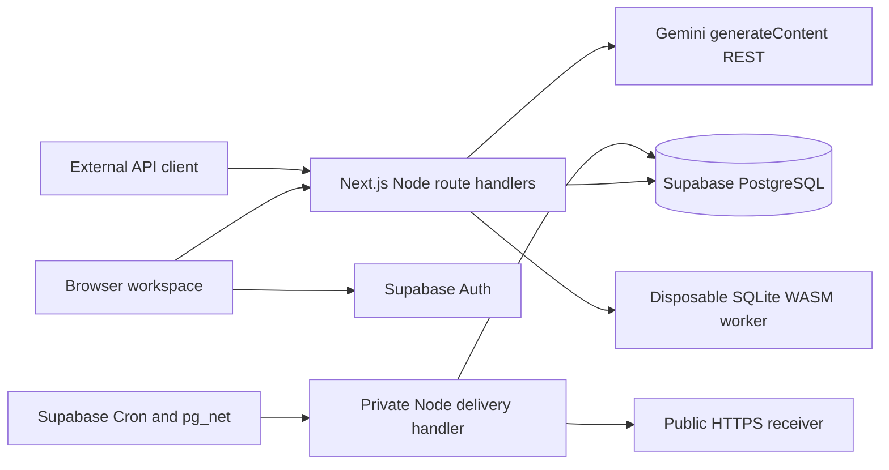

# System design

## Boundaries and flow



One Next.js application serves the UI and versioned API. Server-render the shell and read-mostly pages. Load the editor, split panes and interactive results on demand. Use a single execution service for browser and external clients so timings, limits and history have the same meaning. Route handlers validate Zod input, authenticate the principal, enforce scope and quota, invoke a service and serialize a typed response.

1. Supabase Auth verifies the browser identity. The API adapter resolves a bearer key to its stored owner and scopes. The service obtains identity exclusively from the verified principal.
2. The dataset registry supplies a versioned immutable seed. Without a session ID, execution starts with a fresh seed. In the UI, create an owned session on dataset selection. Persist a bounded SQLite snapshot and monotonic revision for that session. Switching datasets restores its own session. Reset replaces its snapshot with the seed and advances the revision.
3. The isolated worker receives SQL and the practice image. It prepares statements under an engine authorizer, steps through bounded results, measures execution time and returns an updated image only for successful writes. Commit snapshot, history and event intent in one short PostgreSQL transaction after the worker exits. Compare-and-swap the revision to prevent a stale tab overwriting work.
4. The assistant reads the selected practice schema at the current revision. Send the specified system prompt, dialect, identifiers, keys, task and a bounded thread belonging to the same owner and dataset. Never include app records, webhook payloads, credentials, hidden tests or full result sets. Treat schema identifiers and messages as data. Clear context on dataset change. Explicitly indicate if schema changed since a prior turn.
5. Call Gemini REST with server-held credentials, structured output and a deadline. Validate the JSON shape and query intent. For generated SQL, prepare against a throwaway clone to detect unknown names. A prepare check leaves both practice state and execution history untouched. Show a warning for writes classified by the engine. Clarification and hint responses can carry null SQL. Rendering text never initiates execution.
6. A challenge grader starts a fresh seed per test. Compare column count, values and multiplicities. Use ordered sequences for a stated ordering requirement, multisets otherwise. Define deterministic tie breaks or accept permutations within stated tie groups. Compare NULL only with NULL. Keep text case and number types meaningful, compare integers losslessly, specify tolerance only on fixtures requiring floating point. Permit aliases unless names are part of the task. Exceeding a grading limit fails the submission rather than comparing truncated results.
7. Commit an event with its business change, then fan out to subscribed destinations durably. Workers claim due deliveries with `FOR UPDATE SKIP LOCKED` and expiring leases. Record every attempt. After a crash between a remote acknowledgement and a local commit, retry with the same event ID. Receivers deduplicate. The first successful lesson or challenge completion emits one domain event.

## Proposed repository

```text
src/app/(auth)/                 register, callback, recovery and sign-in
src/app/(studio)/               dashboard, workspace, learning and developer screens
src/app/api/v1/                 public authenticated route adapters
src/app/api/account/            session-only keys, saved items and webhooks
src/app/api/internal/           scheduled delivery handler
src/app/api/health/             public readiness check
src/components/                UI primitives, workspace panes and result grid
src/config/                    branding and typed configuration
src/server/                    principals, quotas, repositories and service orchestration
src/server/ai/                 Gemini client, system prompt and response contracts
src/server/sandbox/            isolated worker, limits, serialization and grading
src/server/webhooks/           outbox, signing, transport and attempt logging
content/datasets/              four versioned SQLite seed scripts and manifests
content/learning/              versioned lesson content, challenges and private fixtures
supabase/migrations/           ordered PostgreSQL migrations, grants and RLS
supabase/seed.sql              published catalogue derived from content
public/openapi.yaml            versioned public API contract
tests/                         service, integration, contract and browser acceptance
docs/                          design evidence, runbooks and assessment materials
```

Keep hidden fixtures and solution SQL in server-only imports. The public lesson and challenge representations contain authored examples and sample outputs.

## Relational application schema

Use UUIDs for resource IDs, UTC `timestamptz` for times, and foreign keys for every reference below. Unless a composite key is shown, use `id` as the primary key. User resources carry `owner_id → profiles.id` and `created_at`. Mutable resources also have `updated_at`. Set ownership on the server. Cascade user deletion through personal resources. Retain revisioned content used by submissions.

| Relation | Columns and rules beyond the shared fields |
| --- | --- |
| profiles | id is both PK and FK to auth.users. Display name, email, role ('user' or 'admin'), last_login_at, last_active_at. Auth owns credentials. |
| activity_logs | Nullable user_id FK to profiles, event_type, module, action, status ('success' or 'failure'), description, duration_ms, sanitized jsonb metadata, created_at. Indexed by (user_id, created_at desc), (created_at desc), and (module, event_type). |
| datasets | Stable slug PK, title, seed version, manifest digest. Package matching immutable seeds in the worker bundle. |
| practice_sessions | Owner, dataset FK, seed version, revision ≥ 0, bounded snapshot bytea, expires_at. Unique (owner_id,id). Limit active sessions per owner and purge expired images. |
| conversations / messages | Conversation belongs to owner and dataset. Message references parent, has ordinal, role and validated content. Unique (conversation_id,ordinal). Enforce parent ownership on every load. |
| query_history | Owner, nullable session FK, dataset/version, SQL, status, duration_ms, displayed_row_count, affected_rows, truncated, public error code. Store outcomes once per execution ID. |
| saved_queries | Owner, dataset FK, title, SQL. Save never executes SQL. |
| learning_modules / lessons | Module slug, level and position. Lesson references module and dataset, version, position, published flag, content and assessment reference. Unique (module_id,position). |
| user_progress | PK (owner_id,lesson_id), lesson_version, exercise_passed, score, completed_at and last_seen_at. Server controls completion. |
| challenges / challenge_submissions | Versioned challenge, difficulty, dataset, public prompt and fixture manifest reference. Submission stores owner, challenge/version, SQL, verdict, passed/total counts and duration. Store hidden expectations separately. |
| challenge_completions | PK (owner_id,challenge_id), first passing submission FK, completed_at. |
| api_keys | Owner, name, unique public selector, digest, scopes, created_at, last_used_at, revoked_at. Rotate in a transaction. Never persist the bearer string. |
| api_usage / rate_buckets | Usage grouped by key, route, status and UTC day. Counters keyed by principal or project, quota category and time bucket. Atomic updates and TTL cleanup. |
| webhooks | Owner, validated HTTPS URL, enabled, subscribed event set, encrypted signing key and key version. |
| outbox_events | Owner, event type, immutable event UUID, resource reference, timestamp and minimal event data. Unique business transition key prevents duplicate creation. |
| webhook_deliveries | Event and webhook FKs, status, attempt_count, next_attempt_at, lease token/expiry. Unique (event_id,webhook_id). |
| webhook_attempts | FK to delivery, sequence, started/finished timestamps, remote HTTP status or classified transport failure. Unique (delivery_id,sequence). |
| request_receipts | Unique (principal,operation,idempotency_key), request digest, lease, response reference and expiry. Same key and changed payload returns a conflict. |

Index owner and descending timestamp plus id for history, keys, saved queries and submissions. Index unpublished/published course order, message ordinals, accepted submissions and due delivery times. Use composite owner-parent FKs on denormalized child ownership, enum/check constraints for status and scope values, and byte/count bounds on snapshots, text and fixtures.

Enable RLS for all exposed tables. Policies allow owners to read their profile/resources and manage explicitly editable columns on saved queries and settings. Published curriculum is readable by authenticated learners. Server-owned records (progress verdicts, history, snapshots, digests, quotas and outbox) have restricted writes. Keep secrets and hidden fixtures outside the exposed schema. Use a client bound to the verified user JWT for owner operations. For external keys, use narrowly granted, typed server-side functions with mandatory owner predicates, a fixed search path and explicit execution grants. Test both paths. Never accept a client-provided owner as authority.

## Practice dataset relationships

| Dataset ID | Core tables and relationships |
| --- | --- |
| student_management | students(id,name,marks), courses(id,title), enrolments(student_id,course_id,term). Composite enrolment key, marks in 0–100. |
| employee_management | departments(id,name), employees(id,name,department_id,manager_id,salary). Department FK, nullable self-reference for manager. |
| ecommerce | customers, orders(customer_id), products, order_items(order_id,product_id,quantity,unit_price_cents). Monetary amounts in integer cents. |
| library_management | authors, books(author_id), members, loans(book_id,member_id,loaned_on,returned_on). Nullable return date represents an open loan. |

Use deterministic fictional records with ties, repeated values, NULLs and parents with no children. Derive explorer samples, PK/FK annotations, autocomplete and tutor schema from SQLite introspection. Generate displayed lesson expected outputs using the matching seed version during content verification.
